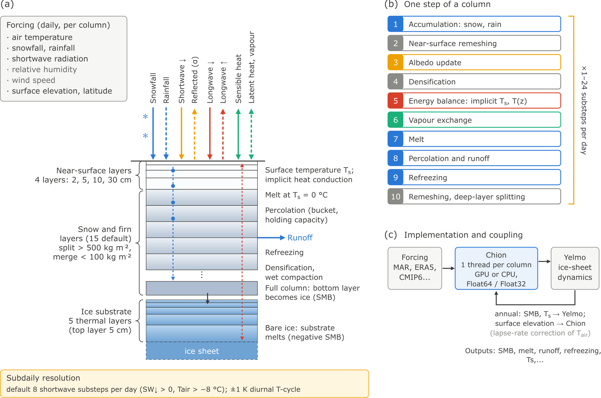

# Chion.jl

```@meta
CurrentModule = Chion
```

Chion is a fast, intermediate-complexity snowpack model for ice sheets and
seasonal snow, written in Julia for CPUs and GPUs. It combines a multilayer
snow and firn model with two bulk surface mass balance models:

- **`BESSIModel`**, the multilayer model. It solves the coupled surface energy
  balance, heat conduction, densification, percolation and refreezing in
  independent vertical columns. Its structure follows the BErgen Snow SImulator
  (BESSI; Born et al., 2019; Zolles and Born, 2021). It extends BESSI with a
  bulk-aerodynamic turbulent-flux scheme, a parameterised longwave radiation,
  a thermal ice substrate, a refined near-surface grid and energy-conserving
  diurnal substeps.
- **`PDDModel`**, a positive-degree-day model with a single snow reservoir.
- **`ITMModel`**, the insolation–temperature–melt model (van den Berg et al.,
  2008; Robinson et al., 2010).



*(a) Forcing and the layered column: four refined near-surface layers, up to
15 snow and firn layers and five thermal ice-substrate layers. (b) The order
of processes within one (sub)step. (c) Typical use: forcing from MAR, ERA5 or
CMIP6 drives Chion on the GPU or CPU, optionally coupled to an ice-sheet
model.*

The minimal forcing is near-surface air temperature, downwelling shortwave
radiation, and snowfall and rainfall. Relative humidity, wind speed, air
pressure, surface elevation and latitude are optional. Each component of the
surface energy balance, the albedo and the melt can also be prescribed, for
example from a regional climate model. The default parameters were calibrated
for the Greenland ice sheet against MAR with daily forcing.

!!! note
    The model is still work in progress and the API may change.

## Installation

```julia
using Pkg
Pkg.activate("path/to/Chion.jl")
Pkg.instantiate()
using Chion
```

NetCDF input and output use `NCDatasets.jl` (installed with Chion). The GPU
backend needs `CUDA.jl`, a weak dependency: add it to your environment
(`Pkg.add("CUDA")`) and load it with `using CUDA` before running with
`backend=:gpu`. Configuration files run with `run_config` load it
automatically.

## Quick Start

A single column with two days of hand-written forcing:

```julia
using Chion

forcing = SnowpackForcing(
    dt_days=[1.0, 1.0],
    air_temperature_c=[-12.0, -10.0],
    snowfall_mm_day=[1.0, 0.0],
    rainfall_mm_day=[0.0, 0.0],
    shortwave_down=[120.0, 160.0],
    latitude_deg=72.0,          # used by the diurnal substeps and the longwave
)
model = BESSIModel(SnowpackGrid(1))
sim = Simulation(model; forcing)
run!(sim)
sim.now.temperature          # the final state: layer temperatures (K), …
```

A gridded run from yearly MAR files with a spin-up and several outputs:

```julia
using Chion
using CUDA                                  # only for backend=:gpu

forcing = Forcing("/data/MAR/MARv3.14.3-10km-daily-ERA5-{year}.nc";
    surface_fluxes=:parameterized)          # Chion computes the energy balance
model = BESSIModel(forcing)

experiment = Experiment(model, forcing;
    years=1940:2026,
    spinup=CycledSpinup(1940:1969; cycles=5),
    outputs=[Output("smb_monthly.nc"; variables=:monthly, frequency=:monthly),
             Output("budget_yearly.csv"; variables=:budget, frequency=:yearly,
                    aggregate=:area_sum)],
    backend=:gpu)
result = run!(experiment)
```

[Running Experiments](experiments.md) describes this workflow and the
equivalent TOML configuration files.

## Where To Go Next

| If you want to | Read |
| --- | --- |
| run the model on files, with spin-up and outputs | [Running Experiments](experiments.md) |
| drive it step by step (coupling, custom loops) | [Simulation API](case_api.md) |
| understand the state and the order of processes | [Model State And Step Flow](model_state.md) |
| look up the physics of one process | the Processes pages, e.g. [Energy Balance](processes/energy.md) |
| find a default value | [Default Parameters](parameters.md) |
| see how the numerics are verified | [Verification](validation.md) |
