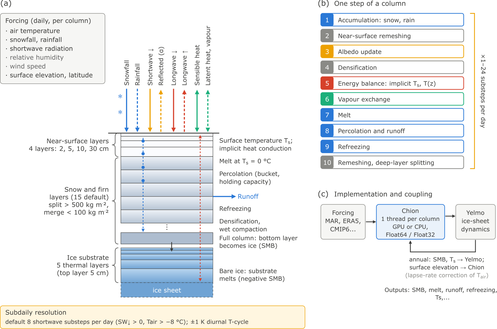

```@meta
CurrentModule = Chion
```

# Model State And Step Flow

This page summarizes the state layout and the main execution order implemented
in `src/step.jl`.



*Schematic of the multilayer snowpack model: forcing, the layered snow and firn
column with refined near-surface layers over the thermal ice substrate, and the
order of processes within one time step.*

## State Model

A model owns its state: `model.state` is the evolving prognostic state, a
`BESSIState`, `PDDState` or `ITMState` on the model's backend.
`initial_state(grid, params)` builds the initial state on the CPU, and a model
built with `state = …` starts from a given one (e.g. a restart). The
diagnostics and scratch arrays live in `model.cache`, and the fields of both
are forwarded (`model.mass`, `model.thickness`). `cpu_state(model)` returns a
host copy and `set_state!(model, state)` copies a host state into the model.

```
Simulation
├── model :: BESSIModel
│   ├── grid :: Grid                    # ncol, optional SpatialLayout (x, y, js, is, mask),
│   │   └── layering :: Layering        #   Ntot, mass_max/split/min, near-surface thicknesses,
│   │                                   #   ice substrate
│   ├── state :: BESSIState             # layers (layer, column): mass, mass_w, density,
│   │                                   #   temperature, ice_temperature; per column N, mass_base,
│   │                                   #   smb_ice, runoff, …, Tsrf, albedo, *_sum SEB accumulators
│   ├── cache :: BESSICache             # workspace (heat solve, boundary_enthalpy), thickness,
│   │                                   #   wet_mass, bulk_density, liquid_water, active columns
│   ├── params :: Params                # constants and schemes (see Parameters)
│   └── forcing :: AtmosphericForcing   # Forcing source, loaded year (host data, kernel fields)
├── clock :: Clock                      # year index, step, iteration, time
├── years, spinup, output               # what run! does (OutputConfig: run directory, outputs)
└── io                                  # output recorders, spin-up done, wall time
```

For `BESSIState`, each column stores one active-layer count `N[idx]` together
with layer-wise arrays for:

| Field | Meaning | Units |
| --- | --- | --- |
| `mass` | solid snow / firn / ice mass per layer | `kg m^-2` |
| `mass_w` | retained liquid water mass per layer | `kg m^-2` |
| `density` | bulk snow density per layer | `kg m^-3` |
| `temperature` | layer temperature | `K` |
| `mass_base` | exported basal ice mass | `kg m^-2` |
| `smb_ice` | cumulative net mass forcing to the ice sheet | `kg m^-2` |
| `runoff` | cumulative liquid-water export | `kg m^-2` |
| `melt` | cumulative melted solid mass | `kg m^-2` |
| `refreezing` | cumulative refrozen liquid mass | `kg m^-2` |
| `vapor_mass` | cumulative net vapour exchange (deposition and condensation positive) | `kg m^-2` |
| `sublimation` | cumulative sublimated mass | `kg m^-2` |
| `latent_heat_flux_sum` | time-integrated latent heat-flux diagnostic | `W m^-2 day` |
| `shortwave_down_sum`, `shortwave_net_sum` | time-integrated shortwave down and absorbed | `W m^-2 day` |
| `longwave_down_sum`, `longwave_net_sum` | time-integrated longwave down and net | `W m^-2 day` |
| `sensible_heat_flux_sum`, `rain_heat_flux_sum` | time-integrated sensible heat and rain heat | `W m^-2 day` |
| `Tsrf` | snow–air (or ice–air) interface temperature | `K` |
| `albedo` | surface albedo used by the energy solver | `1` |
| `snow_age_days` | time since the last snowfall (`AgingAlbedo`) | `day` |
| `w_snow_max` | seasonal maximum snow water equivalent (`SemixAlbedo`) | `kg m^-2` |
| `ice_temperature` | temperatures of the ice-substrate layers, `(ice_substrate_layers, column)` | `K` |

The cache holds the column diagnostics `thickness` (m), `wet_mass`
(kg m⁻²), `bulk_density` (kg m⁻³) and `liquid_water` (kg m⁻²), refreshed by
`update_diagnostics!` (which `run!` calls at the end of every run), and the
scratch arrays of the heat solve with the cumulative `boundary_enthalpy`
(J m⁻²) of the enthalpy budget. `column_profile(model, idx)` returns the
active layers of one column, and `column_enthalpy(model, idx)` its enthalpy.

The surface energy balance sums are positive into the surface. Under snow and
on the ice substrate the terms are evaluated at the solved surface temperature,
on bare ice without a substrate at `T0`. Net shortwave, net longwave, sensible,
latent and rain heat add up to the energy into the column (melt and
conduction), up to the linearization of the solve and the heat of snowfall,
which is not among them.

`PDDState` stores `snowpack_swe`, `smb_ice`, `runoff`, and `pdd_sum` as
column vectors. Its snow reservoir is capped by `H_snow_max` of `PDDParams`.
Refrozen water leaves that reservoir as superimposed ice, and `smb_ice`
therefore contains only snow-to-ice conversion minus ice melt. For every PDD
step, precipitation is partitioned according to
`snowfall + rainfall = Δsnowpack_swe + Δsmb_ice + Δrunoff`.

`SnowpackForcing` stores one forcing matrix per field in model-native units
(`K`, `kg m^-2 s^-1`, `W m^-2`). Its constructor also accepts user-facing
temperature and precipitation fields in Celsius and `mmWE day^-1`.

### Host/device boundary

Before a KernelAbstractions launch, Chion extracts concrete named tuples
containing only the arrays required by that kernel, and passes the isbits
`Params` and `Layering` for inline dispatch on the schemes. Complete state,
forcing, model and simulation objects are not kernel arguments.

Every launch uses an `ndrange` equal to the active-index or output length.
Kernel entry points index that range directly under `@inbounds`; empty work
sets are handled and validated on the host before launch.

## Step Ordering

With the default diurnal substeps (`DiurnalSubsteps()`), a daily forcing step
is first split into substeps (see
[Diurnal Shortwave Cycle](processes/diurnal_cycle.md)); with the default
`longwave_scheme = CloudProxyLongwave()`, the incident longwave is derived once
from the daily forcing before that split. Each substep then executes, for a
snow-covered column:

1. accumulation and rainfall input; snow falling on a previously bare surface
   takes ``\min(T_{\mathrm{air}}, T_0)``; layers emptied below a trace
   threshold are removed and their water runs off
2. near-surface remeshing to the `near_surface_layer_max_thicknesses_m` profile
3. albedo update
4. densification
5. energy solve of the snow column and the ice substrate
6. turbulent vapour exchange (sublimation/deposition, or evaporation/
   condensation at the melting point) on the surface layer
7. melt, when the energy solve diagnoses melt energy; melt in excess of the
   snow melts the underlying ice and runs off
8. percolation
9. HTESSEL liquid-water compaction, with `HTESSELDensification()` and liquid water remains
10. refreezing
11. near-surface remeshing again, so that the next energy solve sees the
    prescribed thin top layers, and the final albedo/snow-age update

If a column has no snow after accumulation, the column step takes the bare-ice branch
and skips the snow-column process chain. With an ice substrate (the default),
the energy solve runs on the substrate with the top substrate layer as the
surface; bare ice cools and must re-warm before melting, and melt and rain run
off. Without a substrate (`Layering(ice_substrate_layers = 0)`), bare ice is held at the
melting point and positive surface energy is converted directly into SMB loss.

For BESSI, `smb_ice` is the cumulative mass transferred to the ice-sheet
reservoir through basal export and bare-ice surface mass changes. Monthly
NetCDF `smb_ice` is the change in that cumulative field during the month.

## Important Defaults

The layering defaults ([`Layering`](@ref)):

- `Ntot = 15`
- `mass_max = 500 kg m^-2`
- `mass_split = 300 kg m^-2`
- `mass_min = 100 kg m^-2`
- `near_surface_layer_max_thicknesses_m = (0.02, 0.05, 0.10, 0.30)`
- `ice_substrate_layers = 5`, `ice_substrate_top_thickness_m = 0.05`

and of the parameters ([`Params`](@ref)):

- `ConstantFreshSnowDensity(density = 315)` kg m⁻³
- `T0 = 273.15 K`

The surface-energy defaults (`SemixSurfaceEnergyBalance()`, `DynamicAlbedo()`
with `alpha_dry, alpha_wet, alpha_ice = 0.81, 0.70, 0.40`,
`CloudProxyLongwave()`, `SemixTurbulentFluxes()` with sensible heat factor 3.0
and stable coefficient 40, `DiurnalSubsteps()` with 8 substeps and a 1 K
temperature cycle) were calibrated against MAR v3.14.3 over Greenland with
daily forcing. All values are listed on [Parameters](parameters.md).

## Entry Points

Most users run a `Simulation` with `run!` (see
[Running Simulations](simulations.md)). Coupled workflows advance it with
`time_step!` or `yearly_step!` and change the inputs in between (see
[Models And Coupling](models.md#Coupling)). `integrate!(model, steps)` steps
a model without a `Simulation`. Every path ends in `column_step!`, which
advances one column by one forcing step and is the function inlined into the
GPU kernel.

```@docs
BESSIState
PDDState
ITMState
initial_state
BESSICache
BulkCache
AtmosphericForcing
update_diagnostics!
column_profile
column_enthalpy
column_step!
```
