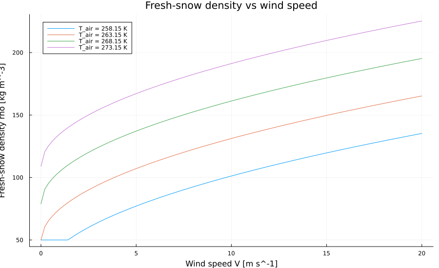

```@meta
CurrentModule = Chion
```

# Accumulation And Melt

Accumulation and melt are handled by the internal helpers
`_apply_accumulation_resolved!` and `_melt_surface_layers!`, which are called
from [`step!`](@ref). They are documented
here because they define the model behavior, but the intended public entry
point is [`step!`](@ref).

## Accumulation

With snowfall rate ``P_{\mathrm{snow}}`` and rainfall rate
``P_{\mathrm{rain}}`` in ``\mathrm{kg\,m^{-2}\,s^{-1}}`` and timestep
``\Delta t`` in seconds, the added masses are

```math
\Delta m_{\mathrm{snow}} = P_{\mathrm{snow}}\Delta t,
\qquad
\Delta m_{\mathrm{rain}} = P_{\mathrm{rain}}\Delta t.
```

If the column is empty, a new surface layer is created only when snowfall is
positive. Rain alone does not create a snow layer, and rain on bare ice (or
on a remnant layer below a trace threshold) runs off. Snow falling on a
previously bare surface takes ``\min(T_{\mathrm{air}}, T_0)`` in every new
layer.

### Fresh-Snow Density

The scheme is selected with the `BESSIModel` keyword `fresh_snow_density`.
With `fresh_snow_density=:constant` (the default), the code uses `rho_s`
(315 kg m⁻³) clamped to `[50, rho_i]`.

With `fresh_snow_density=:parameterized`, the code uses the HTESSEL
formulation (Dutra et al., 2010)

```math
\rho_\mathrm{fresh} = a + b\,(T_\mathrm{air} - T_0) + c\,\sqrt{V},
```

with default coefficients `rho_s_a = 109` kg m⁻³, `rho_s_b = 6` kg m⁻³ K⁻¹
and `rho_s_c = 26` kg m⁻⁷ᐟ² s¹ᐟ², wind speed `V` in m s⁻¹ (5 m s⁻¹ without
wind forcing), and a final clamp to ``[50, \rho_i]``.



If snowfall is added to an existing surface layer, the new bulk density is
mixed by conserving layer volume:

```math
\rho_1^{new} =
\frac{m_1^{old} + \Delta m_{\mathrm{snow}}}
{m_1^{old}/\rho_1^{old} + \Delta m_{\mathrm{snow}}/\rho_\mathrm{fresh}}.
```

Rainfall is added directly to the surface liquid-water store `mass_w[1]` when a
snow layer exists.

### Layer-Structure Enforcement

After mass addition, the code:

1. splits the surface layer when `mass[1] > mass_max`
2. frees space at the bottom when all `Ntot` layers are already active, by
   merging the two deepest layers and exporting any density excess above
   ``\rho_i`` to the ice
3. merges or rebalances the surface when `mass[1] < mass_min`; with
   near-surface layer limits (the default) this minimum is not applied,
   because the remeshing controls the surface layers
4. applies the snow-depth cap described on the
   [Layer Structure And Basal Transfer](layer_structure.md) page
5. remeshes the four uppermost layers to `near_surface_layer_max_thicknesses_m`
   (see [Near-Surface Layers](layer_structure.md#Near-Surface-Layers))

## Melt

If the energy solve holds the surface at the melting point, the energy
available for melt is the difference between the atmospheric flux at
``T_s = T_0`` and the heat conducted into the uppermost layer,

```math
E_{\mathrm{melt}} = \Delta t\left[Q_{\mathrm{net}}(T_0) - G_s\left(T_0 - T_1^{n+1}\right)\right]
```

(see [Energy Balance](energy.md)). `_melt_surface_layers!` consumes this energy
from the surface downward. Because a melting layer can be colder than ``T_0``,
each kilogram costs ``L_m + c_i (T_0 - T_i)`` to warm and melt, so the melt mass
of layer ``i`` is ``E/[L_m + c_i (T_0 - T_i)]``. The melted mass is added to the
layer's liquid water, and the later retention and refreezing decisions are left
to [`go_percolation!`](@ref) and [`go_refreezing!`](@ref).

- layers that melt completely are removed, and their liquid water is passed to
  the layer below
- melt energy left after all snow is gone melts the underlying ice: it lowers
  `smb_ice` and runs off directly
- after melt, the interface temperature `Tsrf` is set to ``T_0``

If melt is prescribed (`prescribed_melt` forcing), the melt mass is taken
directly from the forcing and removed by `_apply_melt!` at latent heat only.
On bare ice, melt follows from the same energy balance with the top
ice-substrate layer as the surface (see
[Layer Structure](layer_structure.md#Ice-Substrate)).

## Interaction In `step!`

The accumulation-and-melt-related ordering in one call to [`step!`](@ref) is:

1. accumulation, removal of trace layers, and near-surface remeshing (or the
   bare-ice branch if no snow is left)
2. albedo update
3. densification
4. [`go_energy_flux!`](@ref)
5. vapour exchange (sublimation/deposition) on the surface layer
6. melt when melt energy is available, or the prescribed melt when
   `prescribed_melt` forcing is supplied
7. [`go_percolation!`](@ref)
8. HTESSEL liquid-water compaction when enabled
9. [`go_refreezing!`](@ref)
10. near-surface remeshing and the final albedo update

The full sequence is listed on [Model State And Step Flow](../model_state.md).

## Internal Reference

```@docs; canonical=false
_fresh_snow_density
_apply_accumulation_resolved!
_melt_surface_layers!
_apply_melt!
```
