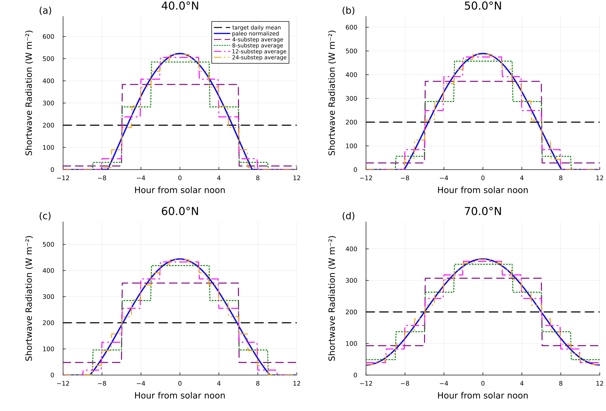

```@meta
CurrentModule = Chion
```

# Diurnal Shortwave Cycle

Chion can subdivide a daily BESSI forcing step to resolve the daytime
shortwave peak. The scheme reconstructs an idealized solar cycle whose
full-day mean equals the supplied shortwave forcing. An optional sinusoidal
air-temperature cycle can be applied over the same substeps.

Daily-mean forcing underestimates melt: around local noon the shortwave flux
can exceed the energy needed for melt even when the daily mean does not. The
substeps capture this without sub-daily forcing. They redistribute shortwave
energy within the day but never change its daily total.

The feature is enabled by default (calibrated for daily GrIS forcing) and applies only to `BESSIModel`.
The low-level `step!` methods, used without a `BESSIModel`, default to no
substeps.



*Reconstructed shortwave flux (blue) for a daily mean of 200 W m⁻² (dashed) at
40, 50, 60 and 70 °N at the June solstice, and its interval means for 4, 8, 12
and 24 substeps. The mean over the day equals the daily mean for any number of
substeps. The default uses 8.*

## Configuration

The defaults correspond to:

```julia
model = BESSIModel(grid;
    diurnal_shortwave_substeps=true,
    diurnal_shortwave_threshold=0.0,
    diurnal_shortwave_max_substeps=8,
    diurnal_shortwave_min_air_temperature_c=-8.0,
    diurnal_temperature_cycle=true,
    diurnal_temperature_amplitude_c=1.0,
)
```

Set `diurnal_shortwave_substeps=false` for forcing that is already sub-daily.

The options mean:

| Option | Default | Meaning |
| --- | ---: | --- |
| `diurnal_shortwave_substeps` | `true` | enable adaptive subdivision |
| `diurnal_shortwave_threshold` | `0 W m^-2` | required noon-peak-minus-mean excess of the selected shortwave (`q_sw_net` if prescribed, otherwise `shortwave_down`) |
| `diurnal_shortwave_max_substeps` | `8` | exact number of substeps when subdivision activates; valid range 1–24 |
| `diurnal_shortwave_min_air_temperature_c` | `-8 degC` | subdivision requires daily mean air temperature above this value |
| `diurnal_temperature_cycle` | `true` | reconstruct a diurnal air-temperature cycle |
| `diurnal_temperature_amplitude_c` | `1 degC` | half-amplitude ``A_0`` of that temperature cycle |
| `diurnal_temperature_amplitude_gradient_c_per_km` | `0 degC km^-1` | increase ``g`` of the amplitude with surface height |
| `diurnal_temperature_amplitude_reference_height_m` | `0 m` | height ``z_{\mathrm{ref}}`` above which the gradient acts |
| `diurnal_temperature_amplitude_max_c` | `1 degC` | upper bound ``A_{\max}`` of the amplitude |

Finite `latitude_deg` forcing is required when diurnal shortwave substeps are
enabled. Solar longitude is derived from each forcing timestamp.

## Solar Geometry

For latitude ``\phi`` and solar longitude ``\lambda``, the implementation
approximates solar declination as

```math
\delta =
\sin^{-1}\left(\sin\epsilon\,\sin\lambda\right),
\qquad
\epsilon = 23.439291^\circ.
```

The sunset hour angle is

```math
h_0 =
\cos^{-1}\left(-\tan\phi\,\tan\delta\right),
```

with explicit polar-night and polar-day limits of ``0`` and ``\pi``.

For hour angle ``h``, the unscaled solar shape is

```math
\mu(h) =
\sin\phi\sin\delta + \cos\phi\cos\delta\cos h.
```

Only the daylight interval ``[-h_0,h_0]`` contributes. Its integral is

```math
I_{\mathrm{day}} =
2\left[
h_0\sin\phi\sin\delta +
\cos\phi\cos\delta\sin h_0
\right].
```

## Energy-Conserving Shortwave Reconstruction

Let ``\overline{Q}_{sw}`` be the supplied daily mean shortwave flux. Chion
scales the solar shape by

```math
S = \overline{Q}_{sw}\frac{2\pi}{I_{\mathrm{day}}}.
```

For a substep spanning hour angles ``[h_a,h_b]``, define the daylight-clipped
bounds

```math
d_a = \max(h_a,-h_0),
\qquad
d_b = \min(h_b,h_0).
```

When ``d_b>d_a``, the interval-mean shortwave is

```math
\overline{Q}_{sw,[a,b]} =
\frac{S}{h_b-h_a}
\left[
(d_b-d_a)\sin\phi\sin\delta +
\cos\phi\cos\delta(\sin d_b-\sin d_a)
\right].
```

Nighttime intervals receive zero shortwave. Integrating all intervals over
``[-\pi,\pi]`` recovers the original daily mean, so subdivision does not alter
the prescribed daily shortwave energy.

If net shortwave `q_sw_net` is prescribed, the same reconstruction is applied
to it. Otherwise it is applied to `shortwave_down`, and albedo is handled by
the normal surface energy calculation.

## Activation Logic

For each column and forcing step, Chion first estimates the noon peak

```math
Q_{\mathrm{peak}} =
S\left(\sin\phi\sin\delta+\cos\phi\cos\delta\right).
```

The step is subdivided only when all of the following are true:

1. diurnal substeps are enabled
2. `diurnal_shortwave_max_substeps > 1`
3. the forcing duration is between `0.75` and `1.25` days
4. the selected daily mean shortwave is positive
5. daily mean air temperature is strictly above the configured minimum
6. air temperature, latitude, and solar longitude are finite
7. `Q_peak - Q_mean` is strictly greater than
   `diurnal_shortwave_threshold`
8. the column is not in polar night

If every condition passes, the code uses exactly
`diurnal_shortwave_max_substeps`; otherwise it uses one normal forcing step.
It does not select an intermediate number of substeps.

## Optional Temperature Cycle

When `diurnal_temperature_cycle=true`, the reconstructed temperature follows
a cosine cycle centered on the supplied daily mean:

```math
T(h) = \overline{T} + A_T\cos h,
\qquad
A_T = \min\!\left[A_{\max},\; A_0 + g\,\max(z_s - z_{\mathrm{ref}}, 0)\right],
```

with the hour angle ``h \in [-\pi, \pi]`` (``h = 0`` at local noon). By
default ``A_T = 1`` K everywhere. Forcing without a surface height gets no
elevation term. The elevation dependence follows the diurnal temperature range
over Greenland in SEMIC (Krapp et al., 2017):
`diurnal_temperature_amplitude_c=2.0`,
`diurnal_temperature_amplitude_gradient_c_per_km=1.0`,
`diurnal_temperature_amplitude_max_c=5.0` reproduce
``A_T = \min(5\,\mathrm{K}, 2\,\mathrm{K} + 1\,\mathrm{K\,km^{-1}}\,z_s)``.

The value passed to a substep is its interval average,

```math
\overline{T}_{[a,b]} =
\overline{T} +
A_T\frac{\sin h_b-\sin h_a}{h_b-h_a}.
```

This places the warmest point at solar noon and preserves the full-day mean
temperature. The temperature cycle only acts on days that are subdivided by
the shortwave criteria above. A day computed as one interval uses the daily
mean. When the option is disabled, every substep uses the original air
temperature.

## Substep Forcing

The full day is divided uniformly in hour angle from ``-\pi`` to ``\pi``.
Each substep receives:

- a timestep scaled by its fraction of the day
- reconstructed interval-mean shortwave
- optionally reconstructed interval-mean air temperature
- unchanged precipitation rates and other atmospheric forcing

Because precipitation remains a rate while the timestep is shortened, total
daily snowfall and rainfall are preserved. Incident longwave from the default
cloud-proxy scheme is derived once from the daily forcing before the split, so
every substep uses the same daily cloudiness. Prescribed melt
(`prescribed_melt`) is distributed over the substeps in proportion to the
reconstructed net shortwave when `q_sw_net` is prescribed and positive, and
otherwise in proportion to the substep length. Both preserve the daily total. Each substep then executes the
normal BESSI column process sequence.
