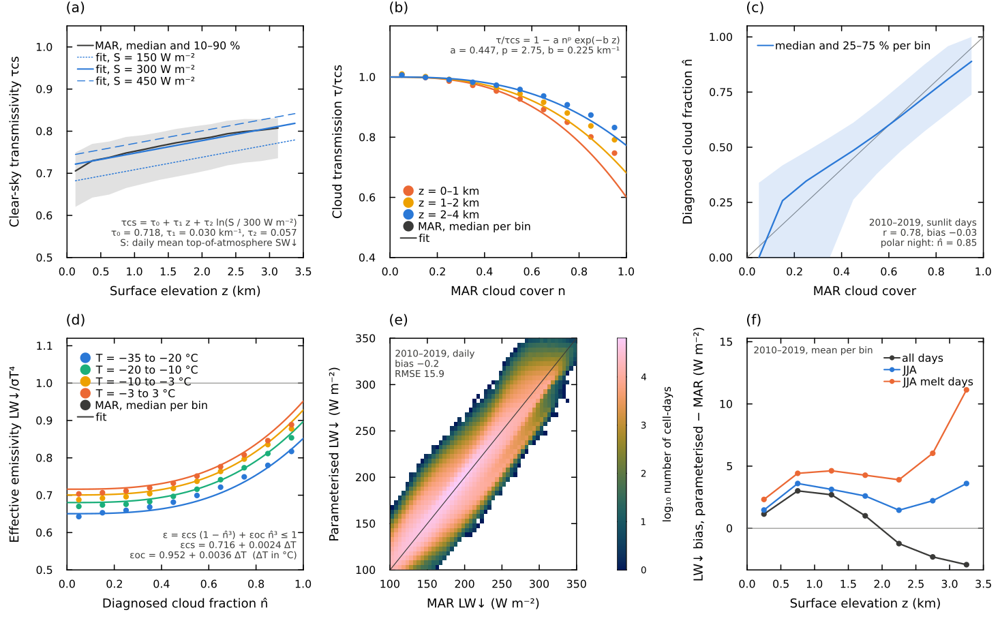

```@meta
CurrentModule = Chion
```

# Energy Balance

`go_energy_flux!` solves the temperature profile of the snow/firn column and
the optional ice substrate below it with one implicit conductive step and a
linearized surface energy balance. The surface temperature `Tsrf` is the
temperature of the snow–air interface; it carries no heat capacity of its own
(Robin boundary). The formulas below follow `src/processes/energy_flux.jl` and
`src/processes/surface_fluxes.jl`.

For daily forcing, the default [Diurnal Shortwave Cycle](diurnal_cycle.md)
subdivides a forcing step before this energy solve is applied.

## Surface Flux Parameterization

At the surface, the model combines absorbed shortwave radiation, longwave
radiation, sensible heat exchange, and precipitation / latent-heat terms into
the surface energy balance ``Q(T_s) = Q_{sw} + Q_{lw} + Q_{sh} + Q_{p} + Q_{lh}``.
The terms are linearized about the previous surface temperature,

```math
Q(T_s) \approx Q_{\mathrm{const}} - Q_{\mathrm{lin}} T_s,
```

and stored as `surface_flux_constant` and `surface_flux_linear`.

### Robin Surface Boundary

The interface temperature balances the surface energy balance against the
conductive flux into the first layer,

```math
Q(T_s) = G_s\,(T_s - T_1),
\qquad
G_s = \frac{2K_1}{\Delta z_1},
```

where ``T_1``, ``K_1`` and ``\Delta z_1`` are the temperature, conductivity and
thickness of the first layer (its centre lies ``\Delta z_1/2`` below the
surface). Solving for the interface temperature,

```math
T_s = \frac{Q_{\mathrm{const}} + G_s T_1}{Q_{\mathrm{lin}} + G_s},
```

and eliminating it leaves the first layer as a regular finite-volume cell,

```math
c_i m_1 \frac{\partial T_1}{\partial t}
= G_s\,(T_s - T_1) + G_{3/2}\,(T_2 - T_1),
```

so the surface forcing enters only the top row of the implicit tridiagonal
system. A thin top layer therefore responds quickly without an artificial
surface heat capacity.

`BESSIModel` uses `turbulent_flux_scheme=:semix` by default for sensible and
latent heat. Set `turbulent_flux_scheme=:bessi` to recover the BESSI bulk
formulation. This choice is independent of `seb_scheme`, which defaults to
`:semix` for consistent graybody longwave exchange, including incident absorption.
Set `seb_scheme=:bessi` for the legacy longwave treatment. Prescribed
`q_sh` or `q_lh` forcing always takes precedence over either parameterization.

### Shortwave Radiation

If `q_sw_net` is not prescribed, absorbed shortwave is

```math
Q_{sw} = (1-\alpha)\,Q_{\mathrm{sw,down}},
```

where ``\alpha`` is the already diagnosed surface albedo stored in
`albedo[idx]`.

### Longwave Radiation

If `q_lw_down` is not prescribed, the default `longwave_scheme=:cloud_proxy`
derives it once per daily forcing step as
``q_{\mathrm{lw,down}} = \epsilon_a\,\sigma T_{\mathrm{air}}^4``. The effective
emissivity weights a clear-sky and an overcast emissivity by a cloud fraction
``n`` (Konzelmann et al., 1994),

```math
\epsilon_a = \epsilon_{cs}(T_{\mathrm{air}})\,(1 - n^q) + \epsilon_{oc}(T_{\mathrm{air}})\,n^q,
\qquad
\epsilon_{cs/oc} = \epsilon_{cs/oc,0} + \epsilon_{cs/oc,T}\,(T_{\mathrm{air}} - T_0),
```

and is limited to ``0.4 \le \epsilon_a \le 1`` (`lw_emissivity_max`). The cloud
fraction is diagnosed from the daily shortwave transmissivity
``\tau = Q_{\mathrm{sw,down}}/Q_{\mathrm{sw,TOA}}`` by inverting the cloud
transmission ``\tau/\tau_{cs} = 1 - a\,n^p e^{-b z}``, with the clear-sky
transmissivity ``\tau_{cs} = \tau_0 + \tau_z z + \tau_S \ln(Q_{\mathrm{sw,TOA}}/300\,\mathrm{W\,m^{-2}})``
(at most one; `clear_sky_transmissivity(c, z, Q_sw_TOA)`). All coefficients were fitted to daily MAR over the Greenland ice
sheet (1980–1989) with `examples/research/fit_cloud_proxy_longwave.jl`:
``\tau_0 = 0.718``, ``\tau_z = 0.0298\,\mathrm{km^{-1}}``, ``\tau_S = 0.0569``,
``a = 0.447``, ``p = 2.75``, ``b = 0.225\,\mathrm{km^{-1}}``,
``\epsilon_{cs,0} = 0.716``, ``\epsilon_{cs,T} = 0.00239\,\mathrm{K^{-1}}``,
``\epsilon_{oc,0} = 0.952``, ``\epsilon_{oc,T} = 0.00362\,\mathrm{K^{-1}}``, and ``q = 3``.
The daily-mean top-of-atmosphere insolation ``Q_{\mathrm{sw,TOA}}`` is
computed from latitude and solar declination with a solar constant of
1361 W m⁻² and the eccentricity factor ``1 + 0.033\cos(2\pi d/365)`` for day of
year ``d``. In the polar night (``Q_{\mathrm{sw,TOA}} \le 50`` W m⁻²), for
sub-daily forcing whose shortwave is not a daily mean (`dt_days < 0.75`), and
for forcing without latitude, ``n`` is the constant `lw_night_cloud_fraction`
(0.85). Without a surface height the sea-level coefficients are used. No
forcing beyond the standard shortwave is needed.



*Fit of the cloud-proxy longwave to daily MAR over the Greenland ice sheet.
(a) Clear-sky shortwave transmissivity against elevation (MAR median and
10–90 % range, 1980–1989) and the fit for daily-mean insolation of 150, 300 and
450 W m⁻². (b) Cloud transmission ``\tau/\tau_{cs}`` against MAR cloud cover for
three elevation bands. (c) Diagnosed cloud fraction against MAR cloud cover,
2010–2019 (r = 0.78). (d) Effective emissivity of MAR against the diagnosed
cloud fraction for four air-temperature classes and the fit. (e) Daily
downwelling longwave of Chion against MAR, 2010–2019 (bias −0.2 W m⁻², RMSE
15.9 W m⁻²). (f) Bias against elevation for summer, summer melt days and the
annual mean.*

The longwave is computed once per forcing interval and held fixed across the
diurnal substeps. The defaults are fitted for Greenland. The Antarctic set used
for the paper runs (`lw_clear_sky_emissivity=0.7314`,
`lw_clear_sky_emissivity_temperature_slope=0.003378`,
`lw_overcast_emissivity=0.9877`, `lw_overcast_emissivity_temperature_slope=0.004171`,
`lw_cloud_emissivity_exponent=2.0`, `lw_night_cloud_fraction=0.9`) is listed
as comments in the Antarctic example configurations.

`longwave_scheme=:graybody` uses the constant ``\epsilon_{\mathrm{air}}`` (`ϵ_air`, 0.8) instead:

```math
Q_{\mathrm{lw}} =
\epsilon_{\mathrm{snow}}\sigma\left(\epsilon_{\mathrm{air}} T_{\mathrm{air}}^{4}
- T_{s}^{4}\right).
```

The emitted longwave term is nonlinear in surface temperature, so the solver
linearizes it about the previous-step temperature ``T_s^n``:

```math
(T_s^{n+1})^4 \approx 4(T_s^n)^3T_s^{n+1}-3(T_s^n)^4.
```

This gives the implemented constant and linear parts

```math
Q_{\mathrm{lw,const}} =
\epsilon_{\mathrm{s}}\left(
q_{\mathrm{lw,down}}
+ 3\sigma(T_s^n)^4
\right),
\qquad
Q_{\mathrm{lw,lin}} =
4\sigma\epsilon_{\mathrm{s}}(T_s^n)^3,
```

where ``q_{\mathrm{lw,down}}`` is the prescribed, cloud-proxy or graybody
incident longwave and ``\epsilon_{\mathrm{s}}`` is the surface emissivity:
`ϵ_snow` (0.98) over snow and `eps_ice` (0.98) over bare ice. Only outgoing
longwave is linearized. The energy diagnostics record the nonlinear flux at the
resolved surface temperature. `seb_scheme=:bessi` (legacy BESSI) absorbs the
incident longwave completely (no ``\epsilon_s`` factor on ``q_{\mathrm{lw,down}}``)
and uses `ϵ_snow` for emission over snow and bare ice alike.

### Sensible Heat

If `q_sh` is not prescribed, the default SEMIX scheme follows the
bulk-aerodynamic formulation of PALADYN (Willeit and Ganopolski, 2016) as used
in SEMIX (Willeit et al., 2024). The neutral transfer coefficient at the
reference height ``z = 10`` m is

```math
C_H^0 = \frac{\kappa^2}{\ln(z/z_{0m})\,\ln(z/z_{0h})},
```

with ``\kappa = 0.4``, the momentum roughness `semix_z0m_snow` (``10^{-3}`` m)
or `semix_z0m_ice` (``10^{-2}`` m) over bare ice, and
``z_{0h} = z_{0m}/`` `semix_zm_to_zh` (10). Stability enters through the bulk
Richardson number and the aerodynamic resistance,

```math
Ri_B = \frac{g z (T_{\mathrm{air}}-T_s)}{T_{\mathrm{air}}\,\tilde u^2},
\qquad
r_a = \left(C_H^0 f_{\mathrm{stab}}\,\tilde u\right)^{-1},
\qquad
f_{\mathrm{stab}} =
\begin{cases}
\sqrt{1-16\,Ri_B}, & Ri_B<0,\\
(1+b\,Ri_B)^{-1}, & Ri_B\geq0,
\end{cases}
```

with ``\tilde u = \max(u, 0.1\,\mathrm{m\,s^{-1}})`` and
``b`` = `semix_stable_coefficient` (40). Turbulent exchange is therefore
suppressed under the stable conditions that prevail over melting and cold
ice-sheet surfaces. The sensible heat flux is

```math
Q_{\mathrm{sh}} = f_H\,\frac{\rho_{\mathrm{air}}c_{p,\mathrm{air}}}{r_a}
(T_{\mathrm{air}}-T_s),
\qquad
\rho_{\mathrm{air}} = \frac{p}{R_d T_{\mathrm{air}}},
```

with ``R_d = 287.05`` J kg⁻¹ K⁻¹ and the exchange factor
``f_H`` = `semix_sensible_exchange_factor` (3.0, calibrated against MAR over
Greenland; 2.5 for the Antarctic set). ``r_a`` is evaluated at the surface
temperature of the previous step and held fixed in the implicit solve. Without
wind or pressure forcing, ``u = 5`` m s⁻¹ and ``p`` follows from the surface
height with the barometric formula (or 101 325 Pa).

With `turbulent_flux_scheme=:bessi`, the code instead uses

```math
Q_{\mathrm{sh}}= D_{\mathrm{sh}}(T_{\mathrm{air}}-T_{s}),
```

with default ``D_{\mathrm{sh}} = 10\,\mathrm{W\,m^{-2}\,K^{-1}}``. In the
linearized form,

```math
Q_{\mathrm{sh,const}} = D_{\mathrm{sh}}T_{\mathrm{air}},
\qquad
Q_{\mathrm{sh,lin}} = D_{\mathrm{sh}}.
```

### Precipitation And Latent-Heat Terms

Snowfall and rain heat terms are directly diagnosed from the forcing
rates in `kg m^-2 s^-1`.

For snowfall, 

```math
H_{\mathrm{snow}} = P_{\mathrm{snow}} c_i,
\qquad
K_{\mathrm{snow}} = P_{\mathrm{snow}} c_i T_{\mathrm{air}},
```

so the snowfall contribution can be written as

```math
Q_{\mathrm{snow}}(T_s) =
K_{\mathrm{snow}} - H_{\mathrm{snow}}T_s
=
P_{\mathrm{snow}} c_i (T_{\mathrm{air}} - T_s).
```

For rainfall onto snow (or, with the ice substrate, onto bare ice), the
current implementation uses a temperature-independent term: rain enters at the
melting point and releases the heat it carries above ``T_0``,

```math
Q_{\mathrm{rain}} =
P_{\mathrm{rain}} c_w (T_{\mathrm{air}} - T_0).
```

If `q_lh` is prescribed, the code treats it as an additional turbulent latent
heat flux. It is added to these snowfall/rain heat-term diagnoses rather than
replacing them. If `q_lh` is not prescribed and relative humidity is
available, the default SEMIX parameterization diagnoses humidity exchange
using the same stability-corrected aerodynamic resistance as sensible heat:

```math
Q_{\mathrm{vap}} =
f_E\,\frac{L(T_s)\,\rho_{\mathrm{air}}}{r_a}(q_{\mathrm{air}}-q_s),
\qquad
q_{\mathrm{air}} = 0.622\,RH\,\frac{e_{\mathrm{sat,i}}(T_{\mathrm{air}})}{p},
\qquad
q_s = 0.622\,\frac{e_{\mathrm{sat,i}}(T_s)}{p},
```

with ``f_E`` = `semix_latent_exchange_factor` (1.0) and the saturation vapour
pressure over ice
``e_{\mathrm{sat,i}}(T) = 611.2\,\mathrm{Pa}\,\exp\!\left(22.46\,\frac{T-T_0}{T-T_0+272.62\,\mathrm{K}}\right)``.
The latent heat follows the surface phase: ``L = L_v + L_m`` (sublimation)
for a subfreezing surface and ``L = L_v`` (evaporation) at the melting point.
With `turbulent_flux_scheme=:bessi`, Chion instead uses the vapor-pressure
parameterization of Rolstad and Oerlemans (2005) and Zolles and Born (2021)

```math
Q_{\mathrm{vap}} =
\frac{D_{\mathrm{lf}}}{p_{\mathrm{air}}}
\left(RH\,e_{\mathrm{sat,w}}(T_{\mathrm{air}}) - e_{\mathrm{sat,i}}(T_s)\right),
```

with

```math
D_{\mathrm{lf}} =
r\,\frac{D_{\mathrm{sh}}}{c_{p,\mathrm{air}}}\,0.622\,L(T_s),
```

where the air vapour pressure is computed over water,
``e_{\mathrm{sat,w}}(T) = 611.2\,\mathrm{Pa}\,\exp\!\left(17.27\,\frac{T-T_0}{T-T_0+243.12\,\mathrm{K}}\right)``.
Here ``r`` is `latent_heat_flux_ratio`, defaulting to 1.0. In both schemes the
saturation vapor pressure over ice is linearized about the previous surface
temperature for the implicit surface solve, and ``L`` is evaluated at that
temperature. Bare ice without a substrate always uses ``L_v + L_m``.

The latent heat flux is accompanied by a mass exchange with the atmosphere.
In the SEMIX scheme and for prescribed `q_lh`, the vapour mass flux is
``Q_{\mathrm{vap}}/L(T_s)``. The BESSI scheme computes it directly from the
vapour-pressure gradient. After the energy solve, a subfreezing surface
exchanges solid mass of the uppermost layer (sublimation and deposition), and a
surface at the melting point exchanges liquid water (evaporation and
condensation). Sublimation is limited to the mass available in the surface
layer. `relative_humidity` may be supplied either as a
fraction (`0.0` to `1.0`) or as percent (`0.0` to `100.0`). If neither `q_lh`
nor relative humidity is
available, the turbulent latent heat term is zero.

When both snowfall and rainfall are positive, the snowfall branch takes precedence in `_diagnose_latent_heat_flux_coefficients`.

### Combined Linearized Surface Forcing

Collecting the terms used by the implementation gives

```math
Q_{\mathrm{const}} =
Q_{sw}
+ Q_{\mathrm{lw,const}}
+ Q_{\mathrm{sh,const}}
+ K_{\mathrm{snow/rain/latent}},
\qquad
Q_{\mathrm{lin}} =
Q_{\mathrm{lw,lin}}
+ Q_{\mathrm{sh,lin}}
+ H_{\mathrm{snow/latent}}.
```

### Surface Energy Balance Diagnostics

The resolved surface energy balance is accumulated in the state as time
integrals in W m⁻² day (positive into the surface), so that dividing by the
elapsed days gives a mean flux: `shortwave_down_sum`, `shortwave_net_sum`,
`longwave_down_sum`, `longwave_net_sum` (nonlinear, at the resolved ``T_s``),
`sensible_heat_flux_sum` (at the resolved ``T_s``), `rain_heat_flux_sum`
(only in steps without snowfall) and `latent_heat_flux_sum`. They are
diagnostics only and do not feed back on the solution. The `:monthly` output
group writes them as monthly means in W m⁻² (see
[Running Experiments](../experiments.md)).

## Diffusion

The vertical diffusion equation is

```math
c_i \rho \frac{\partial T}{\partial t}
= \frac{\partial}{\partial z}\!\left( K(\rho, T)\,\frac{\partial T}{\partial z} \right),
```

where ``\rho`` is the layer density and only the solid mass contributes to
the heat capacity.

### Thermal Conductivity

The conductivity follows Calonne et al. (2019), Eq. (5). It blends regressions
for snow and firn and scales them with the temperature dependence of the
conductivities of ice and air,

```math
K(\rho,T) = \left[1-f(\rho)\right]S_{\mathrm{snow}}(T)\,K_{\mathrm{snow}}(\rho)
          + f(\rho)\,S_{\mathrm{firn}}(T)\,K_{\mathrm{firn}}(\rho),
\qquad
f(\rho) = \frac{1}{1+\exp[-0.04\,(\rho-450)]},
```

with ``\rho`` in kg m⁻³, ``T`` in K and ``K`` in W m⁻¹ K⁻¹,

```math
\begin{aligned}
K_{\mathrm{snow}}(\rho) &= 0.024-1.23\times10^{-4}\rho+2.5\times10^{-6}\rho^2,\\
K_{\mathrm{firn}}(\rho) &= 2.107+3.618\times10^{-3}(\rho-\rho_{\mathrm{ice}}),\\
S_{\mathrm{snow}}(T) &= \frac{K_{\mathrm{ice}}(T)\,K_{\mathrm{air}}(T)}{2.107\times0.024},
\qquad S_{\mathrm{firn}}(T) = \frac{K_{\mathrm{ice}}(T)}{2.107},\\
K_{\mathrm{ice}}(T) &= 9.828\,e^{-5.7\times10^{-3}T},
\qquad K_{\mathrm{air}}(T) = 2.334\times10^{-3}\,\frac{T^{3/2}}{164.54+T}.
\end{aligned}
```

The constants are fixed in the code. There is no user-facing ice conductivity
parameter.

### Interface Conductance

For each layer, the code first computes the layer thickness from the layer's
solid mass ``m_i`` and density ``\rho_i`` (not the ice density):

```math
\Delta z_i = \frac{m_i}{\rho_i}.
```

For the interface between neighboring layers ``i`` and ``i+1``, the helper
`interface_conductance` computes

```math
G_{i+1/2}
=
\left(
\frac{\Delta z_i}{2K_i}
+ \frac{\Delta z_{i+1}}{2K_{i+1}}
\right)^{-1}
=
\frac{2K_iK_{i+1}}
{K_{i+1}\Delta z_i + K_i\Delta z_{i+1}}.
```

and we have

```math
\beta_i = -\frac{\Delta t}{c_i m_i},
```

so the off-diagonal coefficients are proportional to ``\beta_i G_{i\pm1/2}``.

### Ice Substrate

With `ice_substrate_layers > 0` (default 5), the solve continues below the
snow/firn layers into a fixed-geometry layer of glacier ice. Substrate layer
``k`` has density ``\rho_i`` and thickness
``\Delta z_k = 2^{k-1}\,\Delta z_{\mathrm{top}}`` with
`ice_substrate_top_thickness_m` ``= \Delta z_{\mathrm{top}}`` (default 0.05 m,
1.55 m in total for five layers). Its temperatures are stored in
`state.ice_temperature` and are solved in the same tridiagonal system as the
snow, with the usual interface conductance between the deepest snow layer and
the top of the substrate. The base of the substrate is insulated.

When a column has no snow, the top substrate layer forms the surface and the
same Robin boundary applies, with ice emissivity and roughness. Bare ice
therefore cools when the surface energy balance is negative and has to be
re-warmed to the melting point before it melts. Melt and rain on bare ice run
off. With `ice_substrate_layers=0`, bare ice is instead held at the melting
point and only positive surface energy is used.

### Discrete System

For interior layers, the implemented stencil can still be understood in the
usual tridiagonal form

```math
a_i T_{i-1}^{n+1} + b_i T_i^{n+1} + c_i T_{i+1}^{n+1} = r_i,
```

with coefficients assembled from the layer masses, conductivities, and
thicknesses. The surface row additionally includes the eliminated Robin
boundary term, while the bottom row (the deepest snow layer or the base of the
ice substrate) only sees conductive exchange with the layer above.

The multi-layer system is solved with the Thomas algorithm, eliminating from
the bottom row upward. This leaves, for every row below the surface, a relation
``T_i = p_i + q_i T_{i-1}`` that does not involve the surface boundary
condition. Only the surface row differs between a free and a melting surface,
so it is closed last as a single scalar equation for ``T_1``, and the profile
follows from one downward substitution.

## Melt-Point Constraint

If the interface temperature from the free (Robin) surface row exceeds `T0`,
the code:

1. marks the step as needing melt
2. fixes the interface at ``T_s = T_0`` and closes the surface row again,
   keeping the conduction from the surface into the first layer,
   ``G_s (T_0 - T_1)``. Rows below the surface are reused from the single
   upward elimination, so this gives the same profile as a second full solve
   of the system with the Dirichlet surface row.
3. clamps the final profile to `T <= T0`
4. returns the remaining surface energy as melt energy,

```math
E_{\mathrm{melt}} =
\max\!\left(0,\;
\left[Q_{\mathrm{const}} - Q_{\mathrm{lin}} T_0 - G_s (T_0 - T_1)\right]\Delta t
\right).
```

The energy that warms the snow below a melting surface is thus conducted into
the column instead of being melted, and no conductive flux leaves an
above-melting-point surface.

## API

```@docs
go_energy_flux!
```

```@docs; canonical=false
_go_energy_flux_resolved!
```
