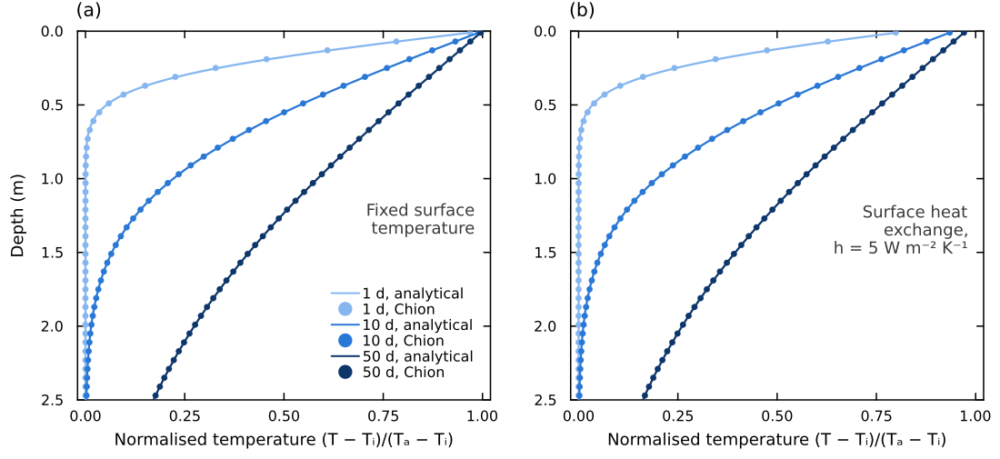
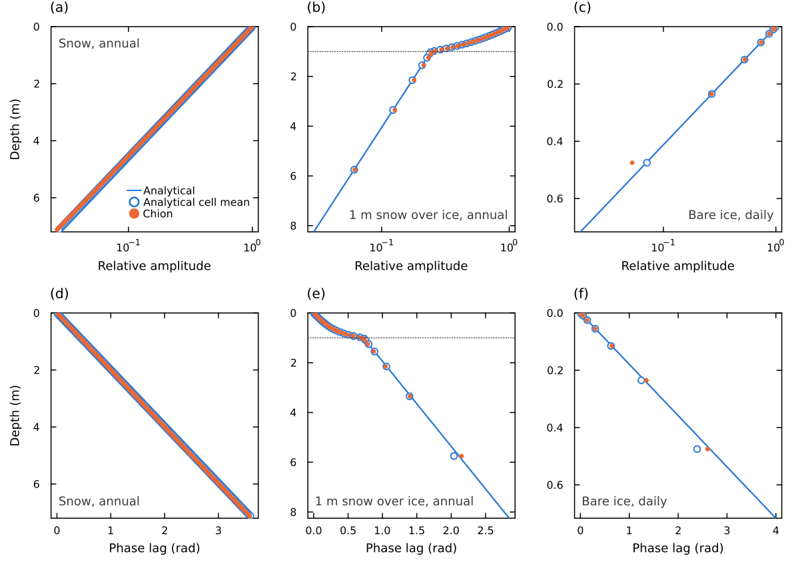
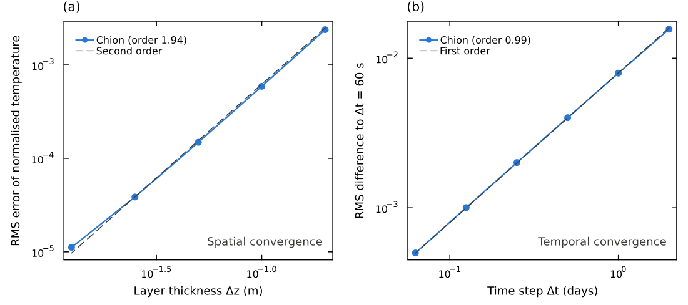
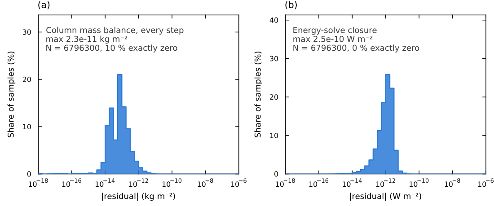
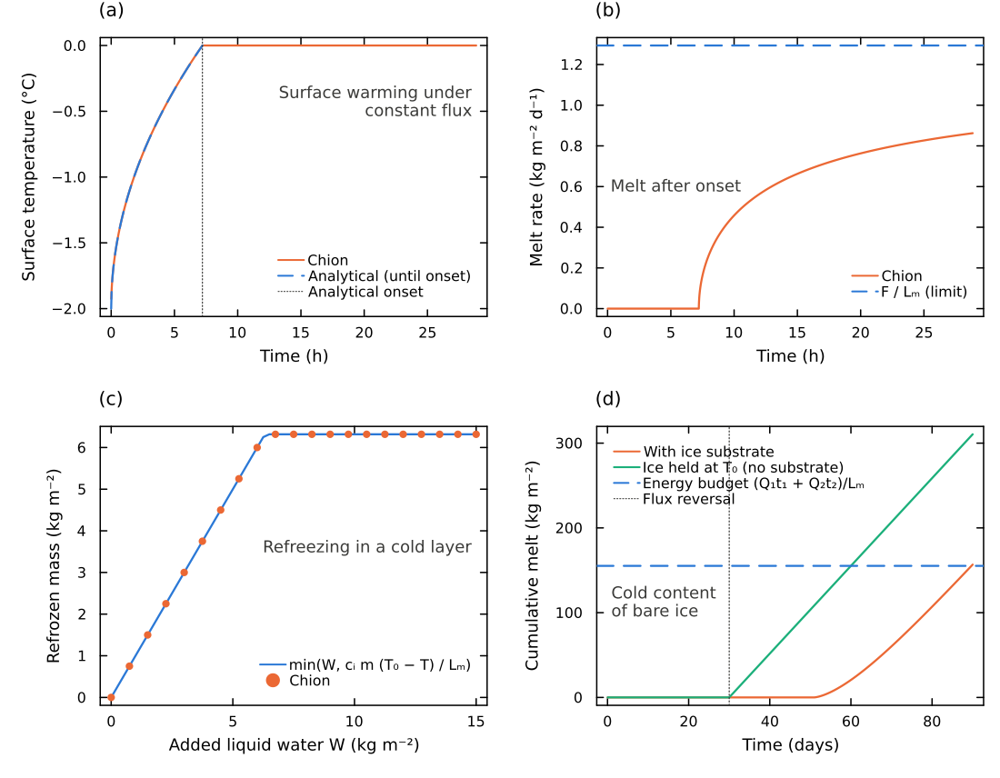

# Verification And Validation

This page summarizes how the numerical core of Chion is verified against
analytical solutions and conservation checks. The figures and numbers are from
the Chion model description paper. Evaluation against observations and regional
climate models (ESM-SnowMIP, Northern Hemisphere snow cover, Greenland and
Antarctic firn and SMB) is reported there and is not repeated here.

The executable checks live in `test/`; run them with
`julia --project -e 'using Pkg; Pkg.test()'`. Relevant files are
`test_longwave_consistency.jl` (insulated equilibrium, graybody longwave),
`test_surface_energy_balance.jl` (closure of the SEB diagnostics),
`test_case_api.jl` (API and scheme selection), `test_experiment.jl`
(the `Experiment`/`Output` workflow), `test_forcing_host.jl` (host forcing
helpers) and `test_gpu.jl` (CPU/GPU agreement, needs `using CUDA`).

## Heat Conduction

The implicit solver is tested in a single column against analytical solutions
for a semi-infinite solid (Carslaw and Jaeger, 1986).

**Step response.** A 6 m snow column (ρ = 350 kg m⁻³, 300 layers of 2 cm,
Δt = 1 h) at −10 °C receives a 1 K surface step, either with a fixed surface
temperature or through a finite surface exchange ``h(T_a - T_s)`` with
``h = 5`` W m⁻² K⁻¹. The analytical solutions are

```math
\theta(z,t) = \operatorname{erfc}(\eta),
\qquad
\theta(z,t) = \operatorname{erfc}(\eta) - \exp\!\left(\frac{hz}{K} + \frac{h^2 \kappa t}{K^2}\right)
\operatorname{erfc}\!\left(\eta + \frac{h\sqrt{\kappa t}}{K}\right),
\qquad \eta = \frac{z}{2\sqrt{\kappa t}},
```

with ``\kappa = K/(\rho c_i)``. The maximum error is 0.63 % of the step after
1 day and below 0.11 % after 10 and 50 days (fixed surface), and 0.57 % and
below 0.1 % with surface exchange.



*Response to a 1 K surface step in homogeneous snow: (a) fixed surface
temperature, (b) surface exchange with h = 5 W m⁻² K⁻¹. Analytical solutions
(lines) and Chion (circles) after 1, 10 and 50 days.*

**Periodic forcing.** A sinusoidal surface temperature (mean −15 °C, amplitude
1 K) drives (i) an annual cycle in snow, (ii) an annual cycle in 1 m of snow
over the ice substrate and (iii) a daily cycle in bare ice. For a homogeneous
medium the solution is a damped, delayed wave
``T = T_m + A e^{-z/d}\sin(\omega t - z/d)`` with ``d = \sqrt{2\kappa/\omega}``.
For snow over ice, a two-layer solution accounts for the reflection at the
interface. In snow, amplitude and phase agree within 2.3 % and 0.015 rad. In
the two-layer case errors stay below 3.4 % and 0.11 rad. In bare ice under
daily forcing, the thin upper cells match. The deepest substrate cells
(≳ 0.15 m, as thick as the 0.18 m daily damping depth) cannot resolve the
daily wave. This is by design: the substrate stores seasonal cold content, and
its coarse cells are accurate for the annual cycle.



*Relative amplitude (a–c) and phase lag (d–f) for an annual cycle in snow
(a, d), an annual cycle in 1 m of snow over ice (b, e) and a daily cycle in
bare ice (c, f). Lines: analytical; open circles: analytical cell means;
filled circles: Chion. Dotted lines mark the snow–ice interface.*

**Convergence.** The fitted orders are 1.94 in space and 0.99 in time, close
to the expected 2 and 1 of the finite-volume implicit-Euler scheme.



*(a) RMS error against the analytical solution versus layer thickness.
(b) RMS difference to a 60 s reference run versus time step.*

## Mass And Energy Conservation

Mass and energy budgets are checked for every column and step of a Greenland
run (365 days × 18 620 columns = 6.8 × 10⁶ samples). The change in stored
solid and liquid mass plus the transfer to the ice equals precipitation minus
runoff plus vapour exchange to within 2.3 × 10⁻¹¹ kg m⁻². With prescribed MAR
surface fluxes, the surface energy input equals the change in heat content of
the snow, firn and ice substrate plus the melt energy to within
2.5 × 10⁻¹⁰ W m⁻².



*Distribution of the absolute residual of (a) the column mass balance and
(b) the energy-solve closure over all columns and daily steps of one year over
Greenland.*

## Phase Change

- **Melt onset.** A 1 m cold snow column (−2 °C) under a constant net flux of
  5 W m⁻² warms as ``T_s - T_{\mathrm{init}} = (2F/K)\sqrt{\kappa t/\pi}``.
  The simulated melt onset differs by 0.049 % from the analytical one, and the
  melt rate afterwards stays below the limit ``F/L_m``.
- **Refreezing.** Liquid water added to a single layer (100 kg m⁻²,
  350 kg m⁻³, −10 °C) refreezes as
  ``\min\left(W, c_i m (T_0 - T)/L_m\right)``, at most 6.32 kg m⁻².
- **Ice substrate.** A flux of −20 W m⁻² for 30 days followed by +20 W m⁻² for
  60 days: without the substrate, bare ice melts as soon as the flux turns
  positive. With it, the cold content must first be removed, and the
  cumulative melt agrees with the net applied energy within 0.95 %.



*(a) Surface temperature under a constant flux and the analytical solution
until melt onset. (b) Melt rate after onset and its limit F/L_m. (c) Refrozen
mass against added liquid water. (d) Cumulative bare-ice melt with and without
the ice substrate after a flux reversal.*

## Further Notes

- [Fresh-Snow Density Note](tests/fresh_snow_density.md)
- [Energy Flux Analytical Tests](tests/test_energy_flux_analytical.md)
